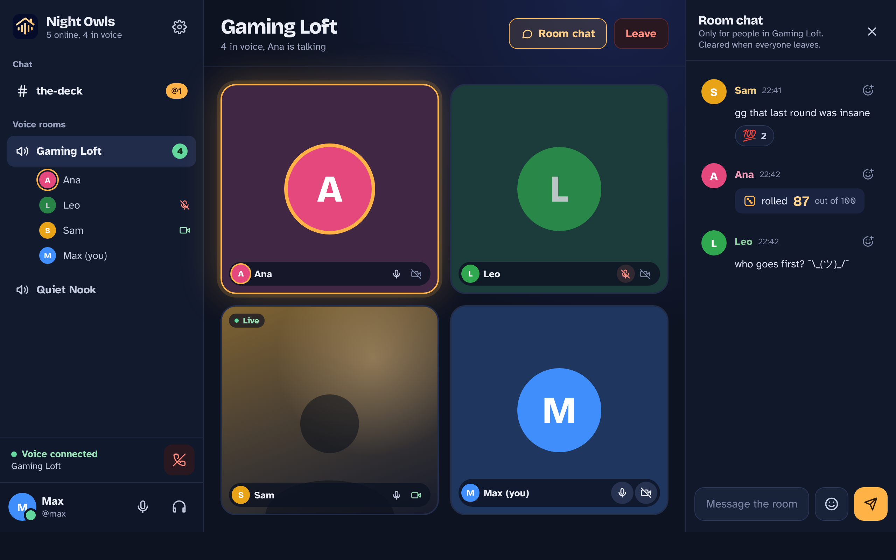

<p align="center">
  
</p>

<h1 align="center">Treehouse</h1>

<p align="center">
  <strong><em>A tiny voice and chat hangout your kids' crew can call their own.</em></strong><br/>
  Private, invite-only, for 3 to 15 friends, on one small server that a parent runs.
</p>

<p align="center">
  
  
  
  
</p>

<p align="center">
  <br/>
  <sub>Design preview from <code>mocks/</code>. The real app follows it closely.</sub>
</p>

## Why

I grew up on Ventrilo. Someone in the crew ran a tiny server, you held a key to talk, and the rules were ours. Nobody else was in there.

My kids live on Discord now. It works, but the sound quality drives me up the wall, and as a parent I have no real say over who is in there or what gets kept, and for how long.

So I built Treehouse: a small private voice and chat hangout for a crew of 3 to 15 kids, which a parent runs on one small server. It's invite-only. There are roles and moderation tools, and messages disappear after a few days. No ads, no strangers, no feed. And it sounds good: clean voice with echo, noise and level processing always on, Opus at 48 kbit/s, nothing to fiddle with. Even the join sounds are your own pick (a ding, a quack, a "hewya!", or yes, a fart).

## What it does

### 💬 The Deck: one text chat for everyone

- @mentions. A message that mentions you is highlighted, and The Deck gets an `@` badge.
- `#room` links show as chips with how many people are in voice. Click one to preview the room and join.
- Slash commands, suggested as you type: `/giphy words` (a GIF picker with Shuffle), `/shrug`, `/roll` (1 to 100) and `/me`.
- Emoji picker, reactions (click a chip to add or remove yours), and deleting your own messages.
- GIFs come through the server, rated PG-13 by default. The app never talks to GIPHY.
- A rate limit of 5 messages per 5 seconds per person keeps the spam down.

### 🎧 Voice rooms

- Two rooms out of the box, Gaming Loft and Quiet Nook. Up to 3 by default, never more than 6.
- Voice runs on a self-hosted LiveKit server. Echo, noise and gain processing are fixed, so nobody has to fiddle with audio settings.
- Optional camera and screen share. Tiles split the stage evenly: one person fills it, two sit side by side, 3 to 4 make a 2 × 2 grid.
- Each room has its own chat, visible only to the people in it, and cleared when the last person leaves.
- Your own join sound, plus microphone and output volume sliders.
- Click a room to peek in, double-click (or press **Join voice**) to hop in. You can choose to join muted, keep the camera off, or join as soon as you open a room.
- Admins manage rooms from a ⋯ menu: size (2 to 10 people), rename, delete, or move everyone back to The Deck and delete.
- Rooms hold 10 people by default, and the server enforces the limit.

### 🔑 Invites, roles and two-step sign-in

- Nobody gets in without an invite. Invites last 1 hour to 7 days and work once or up to 5 times. Admins can cancel any invite that hasn't been used yet.
- Three roles: member, moderator and admin. Moderators can delete anyone's message.
- Two-step sign-in (an authenticator app plus backup codes) is required for admins and optional for everyone else.
- You can see your signed-in devices and sign any of them out.

### 🌙 Desktop niceties

- A tray icon with a mentions-only badge, plus a Dock badge on macOS and a taskbar overlay on Windows. Closing the window keeps Treehouse in the tray.
- Hotkeys: Ctrl+M to mute and Ctrl+D to deafen, and you can change both. The app warns you when a key combination clashes with a system shortcut.
- Statuses: online, away, busy or be right back, with an optional emoji and a short line of text. "Busy" pauses notifications.
- Profile pictures and a name color.
- Signed in-app updates, checked shortly after launch and every few hours.

## How it works

```
  Treehouse app (Tauri 2)                     one small server (docker compose)
 ┌───────────────────────┐   HTTPS + WS    ┌───────┐    ┌──────────────────┐    ┌────────────┐
 │ web UI (TypeScript)   │ ──────────────► │ Caddy │ ─► │ treehouse (Rust) │ ─► │ Postgres 16│
 │ Rust: HTTP, WebSocket,│                 │ (TLS) │    │ 1–2 replicas     │    └────────────┘
 │ token in OS keychain  │                 └───────┘    └────────┬─────────┘
 └──────────┬────────────┘                                       │ tokens, webhooks
            │                 WebRTC (voice, camera, screen)     ▼
            └──────────────────────────────────────────►  ┌──────────────┐
                                                          │   LiveKit    │
                                                          └──────────────┘
```

- **Server:** one Rust binary (axum, tokio, sqlx) in [`server/`](server). Postgres is the only source of truth, and every rule (invite uses, room limits, "always keep one admin") is checked and written in a single transaction. Background jobs and the outbox worker take advisory locks, so running two replicas is safe.
- **Live updates:** every change writes a numbered event in the same transaction, and Postgres `NOTIFY` delivers it only after the commit. The app keeps one WebSocket open and catches up after a reconnect.
- **Voice:** a self-hosted [LiveKit](https://livekit.io). The server hands out 15-minute room tokens, and LiveKit webhooks tell it who is in which room.
- **Caddy** in front handles HTTPS with automatic certificates.
- **Desktop app:** Tauri 2 in [`desktop/`](desktop), with a plain TypeScript UI. It holds no business rules: the server decides and the app shows the result.

The full design is in [docs/spec.md](docs/spec.md), and choices made along the way are in [docs/decisions.md](docs/decisions.md).

## Run your own treehouse

You need a small Linux VPS with Docker, and two DNS names pointing at it: one for the app and one for voice.

1. **Configure.** Copy the example settings and fill in the secrets:

   ```sh
   cp deploy/.env.example deploy/.env
   ```

   | Variable | What it is |
   |---|---|
   | `APP_DOMAIN` | The app's address, for example `treehouse.example.com` |
   | `VOICE_DOMAIN` | LiveKit's address, for example `voice.treehouse.example.com` |
   | `POSTGRES_PASSWORD` | Required |
   | `LIVEKIT_API_KEY`, `LIVEKIT_API_SECRET` | Required. Make a pair with `docker run --rm livekit/livekit-server:v1.9.3 generate-keys` |
   | `GIPHY_API_KEY` | Optional. GIFs are off without it |
   | `SETUP_INVITE_TTL` | How long the setup invite lasts, in minutes (default 120) |
   | `MAX_VOICE_ROOMS` | Voice room limit, 1 to 6 (default 3) |
   | `TREEHOUSE_REPLICAS` | 1 or 2 server copies (default 1) |

   Everything except the secrets has a default. See [deploy/.env.example](deploy/.env.example) for the full list.

2. **Start it.** This starts four containers: the server, Postgres, LiveKit and Caddy.

   ```sh
   docker compose -f deploy/docker-compose.yml --env-file deploy/.env up -d --build
   ```

3. **Become the owner.** On first boot the server prints a setup invite in its log, as a link and as a QR code you can scan in the terminal. It works once and expires after 2 hours:

   ```sh
   docker compose -f deploy/docker-compose.yml logs treehouse
   ```

   Open the app, type your server address, choose **I have an invite code**, and create your account. The app then has you turn on two-step sign-in, because the owner is an admin.

4. **Invite the crew** from Settings → Invite friends.

**Server commands.** These only work from a shell on the server, never from the app:

```sh
docker compose -f deploy/docker-compose.yml exec treehouse treehouse setup-invite            # new setup invite (only while there's no admin)
docker compose -f deploy/docker-compose.yml exec treehouse treehouse admin promote <user>    # make someone an admin
docker compose -f deploy/docker-compose.yml exec treehouse treehouse admin reset-mfa <user>  # turn off their two-step sign-in
docker compose -f deploy/docker-compose.yml exec treehouse treehouse admin unblock <user>    # unblock and unlock an account
```

## Get the app

- **macOS** (Apple silicon and Intel): `Treehouse.dmg`. It's signed and notarized.
- **Windows** (x64): `Treehouse-setup.exe`. It isn't Authenticode-signed yet, so SmartScreen warns you the first time you run it.

Download them from [GitHub Releases](https://github.com/idestis/treehouse/releases/latest): [Treehouse.dmg](https://github.com/idestis/treehouse/releases/latest/download/Treehouse.dmg) for macOS and [Treehouse-setup.exe](https://github.com/idestis/treehouse/releases/latest/download/Treehouse-setup.exe) for Windows. Once installed, the app updates itself from the same releases.

## Develop

Prerequisites: Rust (1.90 or newer), Node and npm, Docker, and [go-task](https://taskfile.dev).

```sh
task setup        # check tools, add Rust targets, install frontend deps
task db           # throwaway Postgres (127.0.0.1:55432) and a dev LiveKit (ws://localhost:7880)
task server:dev   # server on http://localhost:8090; prints a setup invite on an empty database
task dev          # desktop app with hot reload
task dev:app      # debug Treehouse.app launched on its own, so macOS asks mic/camera permission for Treehouse, not your terminal
task verify       # cargo fmt check + clippy -D warnings + tests + TypeScript check
```

Other useful tasks:

| Task | What it does |
|---|---|
| `task db:reset` | Wipe the dev database. The next `task server:dev` starts fresh with a new setup invite |
| `task sqlx:prepare` | Refresh `server/.sqlx` (offline query data) after changing a query |
| `task server:image` | Build the server Docker image (`SERVER_PLATFORM=linux/arm64` for ARM servers) |
| `task up` / `task down` | Run the full production stack locally from `deploy/.env` |
| `task dmg` | Universal, Developer ID–signed macOS DMG |
| `task windows` | Windows x64 installer, cross-compiled from a Mac with `cargo-xwin` |
| `task release` | Preview the notes, bump the version, build both platforms, tag, and publish the GitHub release (the app's update feed) |

Release tooling reads the root `.env` (copy [.env.example](.env.example)). [CLAUDE.md](CLAUDE.md) has the working rules, conventions and the build order.

```
treehouse/
├── server/          # Rust service: HTTP API, WebSocket events, jobs, migrations
├── desktop/         # Tauri 2 app (src-tauri/ is Rust, ui/ is TypeScript + Vite)
├── deploy/          # docker-compose, Caddyfile, LiveKit config, .env.example
├── docs/            # spec.md (start here) and decisions.md
├── mocks/           # clickable HTML design mocks and screenshots (not shipped)
└── brand/           # logo, app icon and artwork
```

## Privacy and safety

- **No strangers.** You can only join with an invite, and only an admin can create one.
- **Your device token lives in the OS keychain.** The web view never sees it.
- **Only hashes are stored.** Tokens, invite codes and backup codes are kept as SHA-256 hashes, and passwords as argon2 hashes. Too many wrong passwords lock the account for a while.
- **Two-step sign-in is required for admins.** The server enforces this, not just the app.
- **Messages are deleted for real** once they reach the message lifetime (3 days by default). Reactions go with them. Room chat is cleared as soon as a room empties.
- **Profile pictures are re-encoded** on the server: cropped to 256 × 256 and saved as a fresh JPEG, so EXIF data such as GPS location is dropped. They're the only uploads, and only signed-in members can see them.
- **Secrets stay on the server.** The GIPHY key, the LiveKit secret and the two-step secrets never reach the app.
- **Your data stays on your server.** It isn't used for ads or analytics. The only outside service is GIPHY, and only when you set a key; the server makes those requests, not the app.

## Roadmap

Done: setup and sign-in, invites, The Deck with all its chat features, live updates, voice with camera and screen share, and room management on the server.

Still to come:

- **Moderation:** the actions from the spec (mute in voice, kick from a room, voice and treehouse timeouts, block), lifting them early, and the moderation log in the app. The outbox worker currently enforces only room deletion in LiveKit; enforcing mutes and kicks comes next.
- **People:** promote, demote and block from the app, with the "always one admin" and owner rules.
- **Admin screens:** treehouse settings (name, message lifetime, GIF rating). Rooms can already be created, renamed, resized and deleted from the room ⋯ menu.
- **Invite links:** the `/join` web page with "Open in Treehouse".
- **Push to talk.** The hotkey can be set, but it doesn't do anything yet.
- **Hardening:** database integration and concurrency tests, backups, a metrics endpoint, and a load test with 15 fake clients.

Later, maybe: quiet hours for school nights, per-person volume, phone apps.

## License

[MIT](LICENSE) © 2026 Dmytro Shamenko
